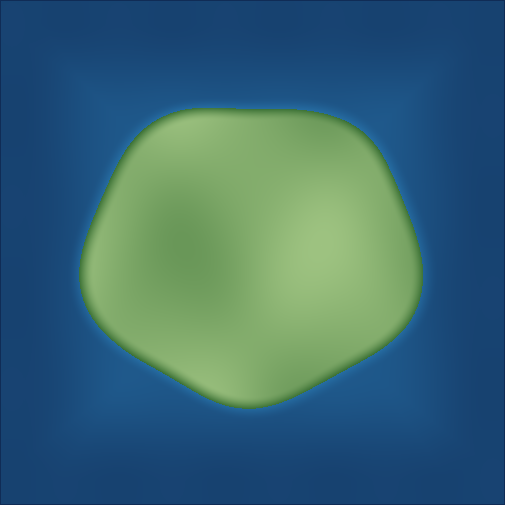

# UEFN Landscape Automation

**Offline, config-driven automation for Unreal Editor for Fortnite (UEFN) Landscape heightmaps.**

This open-source-ready Python tool reads an existing **16-bit grayscale PNG**, applies **non-destructive, water-only seabed deepening**, and produces an importable heightmap, image previews, and machine-readable validation results. It can be called from a terminal, Python subprocess, or an AI coding agent such as **Codex** or **Claude Code**.

> **Scope:** Current release supports the `deepen_seabed` operation. It does **not** design an entire island, place actors or Water Bodies, or import anything into UEFN automatically. UEFN import/reimport requires a human review.

**Project author:** [Hiroyuki Chishiro](https://github.com/chishiro) · **License:** [BSD-2-Clause](LICENSE) · **Python:** 3.11.x (3.11.8 recommended)

### Documentation map

- **New users:** Follow [Get started in 3 steps](#1-get-started-in-3-steps-without-uefn) with synthetic data.
- **UEFN creators:** Read [Use your own UEFN Landscape](#2-use-your-own-uefn-landscape) before importing anything.
- **Configuration:** See [Configuration reference](docs/CONFIGURATION.md).
- **AI coding agents:** Read [the Codex / Claude Code workflow](#4-use-from-codex--claude-code--other-coding-agents) and [`AGENTS.md`](AGENTS.md).
- **Contributors:** See [tests and CI](#5-run-tests-and-contribute) and [future development ideas](#7-future-development-ideas).

## Why use it?

- **Project-agnostic:** No hard-coded project names, 505×505 dimensions, actor coordinates, or local paths. Works with any supported PNG dimensions; the image must separately be suitable for the target UEFN Landscape.
- **Configurable:** Set world-coordinate transform, row orientation, sea sample, water threshold, shoreline blend, map-edge depth and protected zones in JSON.
- **Correct distance metric:** Calculates the *exact Euclidean distance to the nearest land pixel centre*, not approximate 8-neighbour queue distances. Uses the configured X/Y pixel size (including unequal scales).
- **Safe by default:** Never rewrites the source PNG, preserves protected regions and source land above the configured cutoff, never raises elevation, fails validation on unexpected changes, and refuses to overwrite generated outputs unless `--force` is passed.
- **Auditable:** Produces `report.json` for scripts/agents and `report.md` for human inspection. Never claims that Y orientation is "verified" without measured control points.
- **No runtime third-party dependencies:** Python **3.11.x** (3.11.8 recommended) with the standard library. `pytest` is required only to run developer tests.

## Python requirements and UEFN compatibility

- **Supported Python:** Python **3.11.x**, with **3.11.8** as the reference version.
- **Why 3.11.8?** Epic's Unreal Engine 5.8 Python Editor Script Plugin embeds Python 3.11.8. Matching that minor version reduces friction when adding future integrations. Always check your installed UEFN build if using in-editor Python.
- **Execution model:** This release is an **external, offline command-line utility**. It does not run inside UEFN, use the UEFN Python API, or require enabling Python scripting in UEFN. Heightmap import remains a separate manual step. Python 3.11 compatibility does **not** imply editor integration has been implemented or tested.
- **CI baseline:** GitHub Actions tests the package and command using Python 3.11.8. Other Python versions are not part of the supported/tested range.

Check your installed Python version:

```bash
python --version
# Expected: Python 3.11.x
```

On Windows, select Python 3.11 explicitly with `py -3.11`; on macOS/Linux, `python3.11` typically selects it. For an isolated environment:

```bash
# Windows PowerShell
py -3.11 -m venv .venv
.venv\Scripts\Activate.ps1

# macOS/Linux (run instead of the above Windows commands)
# python3.11 -m venv .venv
# source .venv/bin/activate

python --version
```

Once activated, the commands below use the selected environment's `python`. For the editor's API, see [Epic's Python documentation](https://dev.epicgames.com/documentation/unreal-engine/scripting-the-unreal-editor-using-python).

## 1. Get started in 3 steps (without UEFN)

From the repository root (the folder containing this `README.md`):

```bash
# 1. Make a fictional 505x505 16-bit PNG; no project assets needed.
python scripts/make_demo_heightmap.py --output assets/input/demo_heightmap_505.png

# 2. Generate an adjusted heightmap and reports.
python src/landscape_tool.py generate \
  --input assets/input/demo_heightmap_505.png \
  --config examples/demo_config.json \
  --output-dir outputs/demo

# 3. Independently validate the generated heightmap against the source.
python src/landscape_tool.py validate \
  --input assets/input/demo_heightmap_505.png \
  --candidate outputs/demo/heightmap.png \
  --config examples/demo_config.json
```

The commands above use Bash-style line continuation (`\`). On **Windows PowerShell**, use the commands on separate lines without backslashes:

```powershell
python scripts/make_demo_heightmap.py --output assets/input/demo_heightmap_505.png
python src/landscape_tool.py generate --input assets/input/demo_heightmap_505.png --config examples/demo_config.json --output-dir outputs/demo
python src/landscape_tool.py validate --input assets/input/demo_heightmap_505.png --candidate outputs/demo/heightmap.png --config examples/demo_config.json
```

If `python` does not resolve to Python 3.11 on Windows, activate the Python 3.11 virtual environment shown above, or use `py -3.11` in place of `python`. On macOS/Linux, `python3.11` can be used when no virtual environment is active.

The `assets/input/` and `outputs/` directories are **local working directories**: they are created as needed and ignored by Git. You do not need an `assets/` folder in the public repository. Only the synthetic illustration images in `docs/images/` are tracked.

These images show the output from the **synthetic demo**, not a real Fortnite island:

| Generated terrain preview | Lowered-seabed difference preview |
| --- | --- |
|  |  |

The second command writes these files:

| File | Use |
| --- | --- |
| `outputs/demo/heightmap.png` | **16-bit grayscale** heightmap for manual UEFN import |
| `outputs/demo/preview.png` | RGB preview for inspection; **do not import** as terrain |
| `outputs/demo/difference.png` | RGB visualization of how much the source was lowered |
| `outputs/demo/report.json` | Machine-readable metrics, status, source SHA-256 and orientation state |
| `outputs/demo/report.md` | Human-readable report and warnings |

The output directory is created automatically. If you run generation a second time with the same directory, use a different output directory or `--force` **only after reviewing the existing results**. `--force` still refuses to overwrite the original source image.

To check settings **without creating files**:

```bash
python src/landscape_tool.py generate --input assets/input/demo_heightmap_505.png --config examples/demo_config.json --dry-run
```

**Exit codes:** `0` means the command passed; `1` means an input, configuration, or validation error. Treat nonzero exit codes as a failed job and do not import its outputs.

### Optional: install the command as a local Python CLI

Instead of running `python src/landscape_tool.py`, you can install the package in
an isolated Python environment and call `uefn-landscape` directly:

```bash
python -m pip install -e .
uefn-landscape --help
uefn-landscape generate \
  --input assets/input/demo_heightmap_505.png \
  --config examples/demo_config.json \
  --dry-run
```

This step is optional. A virtual environment is recommended if you do not want
to install the command into your system Python. Package installation requires
`pip` and its build tooling; running the script directly uses only Python's
standard library.

## 2. Use your own UEFN Landscape

1. In UEFN, **back up/version-control your island** and export the existing Landscape heightmap as a **16-bit grayscale PNG**. This tool does not perform an export.
2. Keep your exported PNG **outside Git-tracked public content** (e.g. `assets/input/my_island.png`, ignored by `.gitignore`). Do not commit game assets, private map layouts, project files, or actor data unless you have confirmed the right to redistribute them.
3. Copy `examples/demo_config.json` to your own private filename (for example `assets/private/my_island_config.json`). Adjust every value to match your landscape; **the example transform and sea level are synthetic**.
4. Verify `landscape.transform` and `row_zero_world_y` against your exported PNG. A PNG alone does not establish whether its first row represents minimum or maximum world Y.
5. Make sure `ocean.sea_level_sample` matches your intended water surface height **in the landscape's 16-bit sample space**. The tool **does not** inspect any Ocean actor.
6. First run `generate --dry-run`; inspect the metrics, then generate into a *new* output directory. Review `preview.png`, `difference.png` and `report.md` before proceeding.
7. Run `validate` against `heightmap.png`, then manually re-import **only `heightmap.png`** into your existing UEFN Landscape using the editor's supported workflow. Keep the existing landscape transform and component layout consistent with the source, and inspect protected sites, land, beach and all edges before saving.

Example with your own files:

```bash
python src/landscape_tool.py generate \
  --input assets/input/my_island.png \
  --config assets/private/my_island_config.json \
  --output-dir outputs/my_island_v1

python src/landscape_tool.py validate \
  --input assets/input/my_island.png \
  --candidate outputs/my_island_v1/heightmap.png \
  --config assets/private/my_island_config.json
```

**Supported inputs:** single-channel, non-interlaced **16-bit grayscale PNG** (PNG color type 0) with common filters; 8-bit RGB, indexed PNG, 16-bit RGB, `.r16`, `.raw`, and EXR are **not** supported by this CLI. Dimensions are read from the PNG and retained. Unreal Landscape has its own valid dimension rules; for example, 505×505 and 1009×1009 are documented recommended configurations. The CLI does not certify import compatibility for arbitrary dimensions or configurations.

Epic references: [Importing and Exporting Landscape Heightmaps](https://dev.epicgames.com/documentation/en-us/unreal-engine/importing-and-exporting-landscape-heightmaps-in-unreal-engine), [Landscape Technical Guide](https://dev.epicgames.com/documentation/en-us/unreal-engine/landscape-technical-guide-in-unreal-engine). Check the documentation for **your installed UEFN version** before reimporting.

## 3. Understand and edit the JSON configuration

See [Configuration reference](docs/CONFIGURATION.md) for every field and unit. Here is the structure (numbers are **fictional demo values**):

```json
{
  "schema_version": 1,
  "name": "My coastal island",
  "landscape": {
    "row_zero_world_y": "min",
    "transform": {
      "origin_xy_cm": [-25200, -25200],
      "location_z_cm": 0,
      "scale_xyz_cm": [100, 100, 100]
    }
  },
  "ocean": {
    "sea_level_sample": 30000,
    "land_threshold_offset_samples": 75
  },
  "operation": {
    "type": "deepen_seabed",
    "shore_start_m": 18,
    "shore_full_depth_m": 150,
    "shore_extra_samples": 1500,
    "boundary_start_m": 22,
    "boundary_end_m": 130,
    "boundary_extra_samples": 1500,
    "edge_target_sample": 25500
  },
  "protected_regions": [],
  "orientation_checks": [],
  "validation": {"require_all_edges_below_sea": true}
}
```

**How it decides what to edit:** `source_sample > sea_level_sample + land_threshold_offset_samples` is considered **land** and is never changed. All other samples are candidates for **lowering**, except protected pixel regions. Depth is blended based on true Euclidean distance in **metres** from the nearest land pixel centre and distance from the image boundary. It never raises samples. The outermost editable samples are capped at `edge_target_sample`, if that is lower than their generated elevation. If the output boundary remains above sea level (e.g. because of uneditable land or a protected edge), default validation fails rather than editing protected data.

**Coordinate conversion:** `origin_xy_cm` is the world position of the **minimum-X and minimum-Y pixel**, not automatically the Landscape actor location. `scale_xyz_cm` is the actual world scale you want to use for sample spacing. With row 0 set to `"min"`, pixel row 0 is the minimum world Y; with `"max"`, it is the maximum world Y. Use measured control points under `orientation_checks` to validate the chosen row direction. Without them, the report says **configured_not_independently_verified**, even if the PNG is generated successfully. If the measurements also fit the opposite direction, the status is **control_points_consistent_but_orientation_ambiguous** instead of claiming verification. World Z is reported using `location_z_cm + (sample - 32768) * scale_z / 128`.

## 4. Use from Codex / Claude Code / other coding agents

This repository is designed to be **called by an agent through shell commands**, not to provide a native MCP server or a UEFN editor plugin.

**Agent instructions:** Read [`AGENTS.md`](AGENTS.md) (used by Codex and compatible tools) and [`CLAUDE.md`](CLAUDE.md) (Claude Code entry point) before asking an agent to edit or run the workflow.

Copyable prompt:

> You are working in the `uefn-landscape-automation` repository. Read `AGENTS.md` and `docs/CONFIGURATION.md`. Do not modify any original or ignored heightmap. First inspect the provided JSON configuration and use `generate --dry-run`. Report the configured row orientation and whether it is independently verified; do not invent UEFN actor measurements. If validation passes, run `generate` into a **new** output directory, inspect `report.json`, then run `validate`. Present the output paths and any uncertainty to me. **Never operate UEFN or import a heightmap without my explicit review.**

An agent can parse `outputs/<job>/report.json` and use the boolean `statistics.passed`, `orientation.status`, and process exit status as checks. The separate `validate` command also recomputes the expected pixels and fails if the candidate contains any unexpected differences (`statistics.expected_mismatched_samples`). For example:

```python
import json
import subprocess

command = [
    "python", "src/landscape_tool.py", "generate",
    "--input", "assets/input/my_island.png",
    "--config", "assets/private/my_island_config.json",
    "--output-dir", "outputs/agent_run_001",
]
subprocess.run(command, check=True)  # abort if validation fails
with open("outputs/agent_run_001/report.json", encoding="utf-8") as file:
    report = json.load(file)
assert report["statistics"]["passed"]
print(report["orientation"]["status"])
```

Do not assume that successful *offline sample validation* proves the result is correct in a live Fortnite island. Protected regions may need manually measured coordinates, and UEFN's landscape orientation, dimensions and transforms must be checked on-screen.

## 5. Run tests and contribute

```bash
python -m pip install pytest
python -m pytest
```

The tests cover exact (including anisotropic) shoreline distances, PNG data integrity, protected regions, validation failures, expected-output matching, and CLI behavior. GitHub Actions tests and exercises the installed CLI on Python 3.11.8. Core execution itself does not require pytest.

**Continuous integration:** [`.github/workflows/tests.yml`](.github/workflows/tests.yml) runs on `pull_request` updates and pushes to `main`. It uses **Ubuntu 24.04** and **Python 3.11.8**, then installs the package, runs pytest, and smoke-tests the CLI. For a PR, check the test run associated with its **latest commit** in [Actions](https://github.com/chishiro/uefn-landscape-automation/actions). An older failed run is not evidence that the latest commit failed; conversely, a conflict-free PR is not evidence that tests passed. The workflow currently has no manual `workflow_dispatch` trigger.

Development flow: `fix:` for correctness changes; `feat:` for configuration/CLI changes; `docs:` for README and agent docs; `chore:` for licensing and automation. Suggested staging commands are in [Git commit guide](docs/GIT_COMMITS.md).

## 6. Security and limitations

- Offline utility only; **no direct UEFN import, actor editing, island saving, or material modification**.
- Only an ocean/seabed **heightmap transformation** is implemented. No river, beach, island coastline or Water Body placement in the current public version.
- The input file stays untouched. Local config and inputs may reveal a project's layout; keep them outside the public repository.
- Preview colors are only illustrative, **not physically accurate material/water appearance**.
- If the source contains no land pixels according to your cutoff, the tool fails. If land or protected regions touch a boundary, the strict edge check may fail (can be explicitly disabled, but investigate the cause first).
*This is an independent community tool, not an official Epic Games product.*

## 7. Future development ideas

The following items are **proposed work**, not features available in the current release:

- [ ] Expand supported heightmap formats and add explicit UEFN dimension checks.
- [ ] Add reusable configuration presets and clearer orientation/calibration diagnostics.
- [ ] Support batch processing and comparison reports for multiple heightmaps.
- [ ] Investigate UEFN editor integration when a suitable, supported API is available; keep offline generation usable independently.

Open an issue before implementing a major new operation so scope and compatibility can be discussed first.

## 8. Author and license

**Author:** [Hiroyuki Chishiro](https://github.com/chishiro)

Licensed under the **BSD 2-Clause License**; see [`LICENSE`](LICENSE). The author's name does not by itself establish legal copyright ownership. **Before publishing**, replace the `<COPYRIGHT HOLDER>` placeholder in `LICENSE` with the actual copyright holder and verify rights to any imported code or assets. The license applies to this repository's code, not to third-party Fortnite/UEFN materials.
